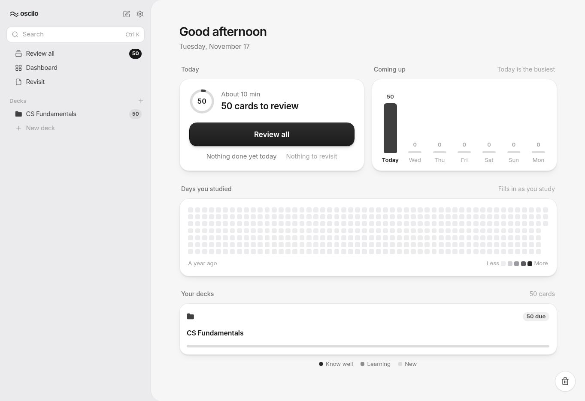
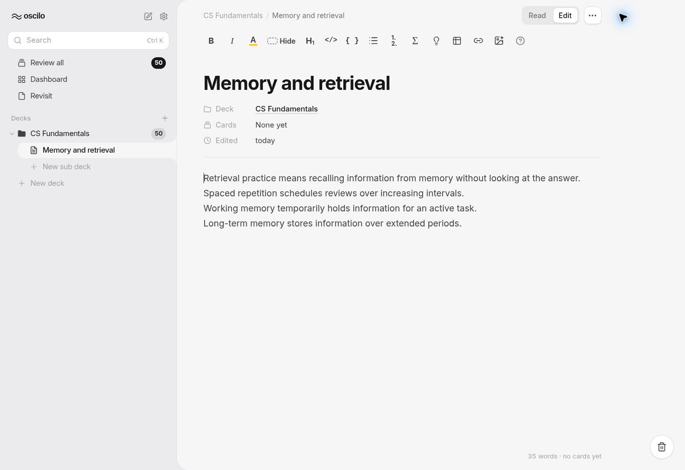
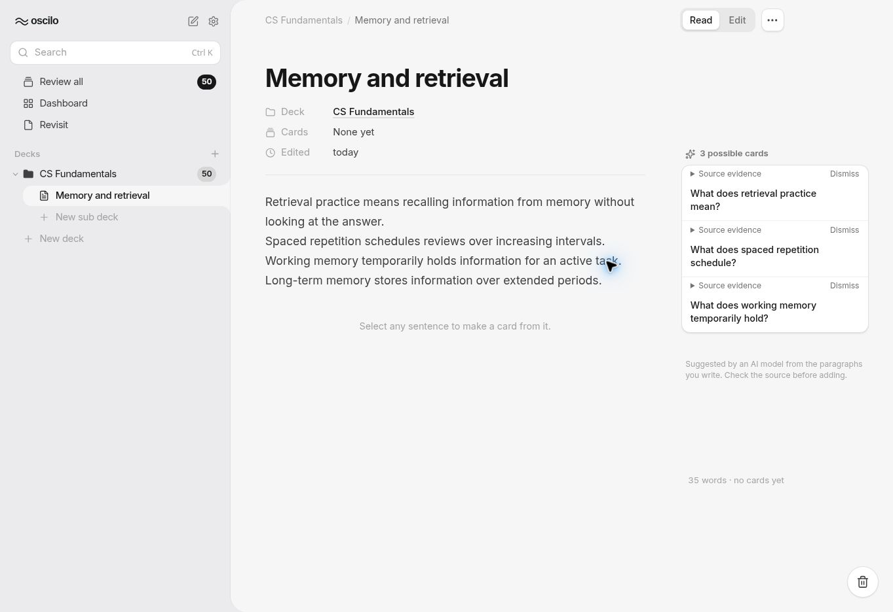
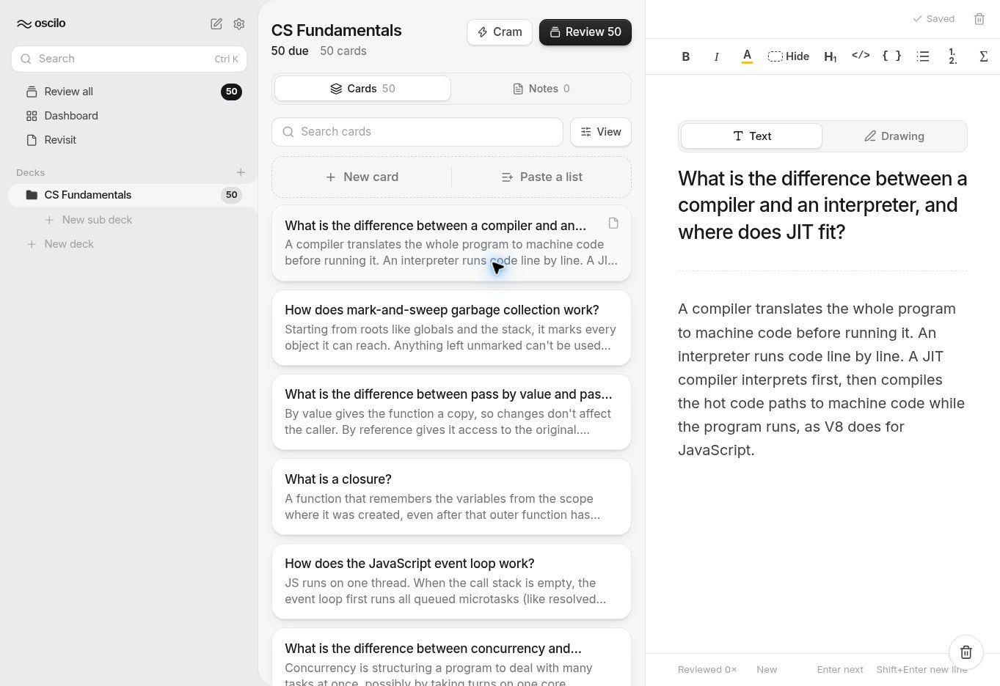
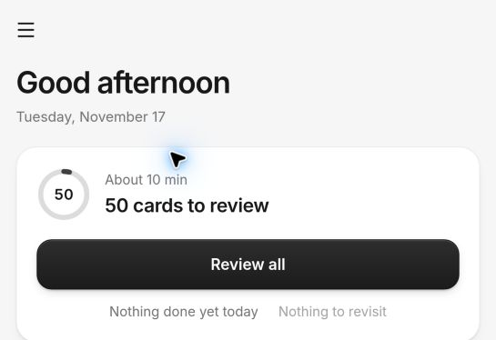
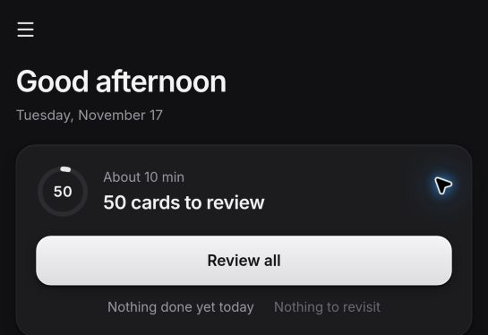

<picture>
  <source media="(prefers-color-scheme: dark)" srcset="assets/oscilo-logo-filled-white.svg" />
  <source media="(prefers-color-scheme: light)" srcset="assets/oscilo-logo-filled-black.svg" />
  
</picture>

### Learn it. Keep it.

**Notes, thoughtful AI flashcards, and adaptive spaced repetition, built to make knowledge last.**

---

## Your notes. Your knowledge.

Oscilo brings writing and remembering into one focused workspace. Capture what you're learning, turn it into questions worth reviewing, and watch your knowledge become more dependable over time.

### AI flashcards that stay grounded in your notes

Most important: **Oscilo generates suggestions from the note you wrote, not a search of the wider internet.**

- **Source-grounded:** Prompts restrict generation to facts explicitly present in your note, rather than filling gaps with outside information.
- **Atomic questions:** Each suggested card focuses on one testable fact, with a clear question that makes sense on its own.
- **Less fluff:** The system is instructed to skip opinions, vague claims, unsupported details, and content that isn't suitable for recall practice.
- **You stay in control:** Review suggested cards before adding them to your deck.
- **Responsive editing:** Debounced requests and caching keep suggestions from constantly interrupting writing.

The current AI integration uses GPT-OSS 20B via Groq with structured responses and request safeguards. **AI can still make mistakes**; the grounding rules are designed to reduce hallucinations, not guarantee their absence.

## See Oscilo

Fresh captures from the live application on November 17, 2026. The notes example uses non-private sample learning material; the suggestions shown were produced by the app.

### Your learning at a glance

### Write notes and review AI suggestions

Suggestions appear in Read mode, where you can inspect the source before adding a card.

### Make every card your own

### Mobile layout in light and dark

These are genuine captures of the app's responsive layout at a 545 CSS-pixel viewport, using browser zoom. They show the top of the dashboard, rather than a physical phone or device-emulation capture.

| Light | Dark |
| --- | --- |
|  |  |

A separate memory-insights view was not available in this session. The dashboard shows the current review forecast and empty study history; no review history was manufactured for these captures.

## Built for lasting learning

| Feature | What it does |
| --- | --- |
| **FSRS-6 spaced repetition** | Adapts review intervals using a C++ scheduler compiled to WebAssembly. |
| **Memory forecasts** | Shows estimated retention and upcoming review needs. |
| **Notes + cards** | Keeps source material close to the questions you practice. |
| **Flexible sessions** | Review due cards, cram, or revisit material that needs more attention. |
| **Rich content** | Supports formatted text, syntax-highlighted code, and LaTeX math. |
| **Granular practice** | Hidden words and ordered steps can be reviewed independently. |
| **Decks and subdecks** | Organize subjects without losing sight of overall progress. |
| **Designed for focus** | Mobile-friendly gestures, multiple themes, and offline-friendly navigation. |
| **Your data** | Local browser storage with import/export backups. |

## Why Oscilo?

**Learning something once isn't the same as being able to recall it later.**

Oscilo is built around that difference. Notes help you capture and organize information. Retrieval practice tests what you can actually remember. Adaptive scheduling helps you return to it at useful intervals. Memory insights make progress visible without turning learning into a streak competition.

The goal isn't to spend more time reviewing. It's to **remember more of what matters**.

---

**Oscilo: Learning at the rhythm of memory.**

*In development · Application source code is maintained privately.*

