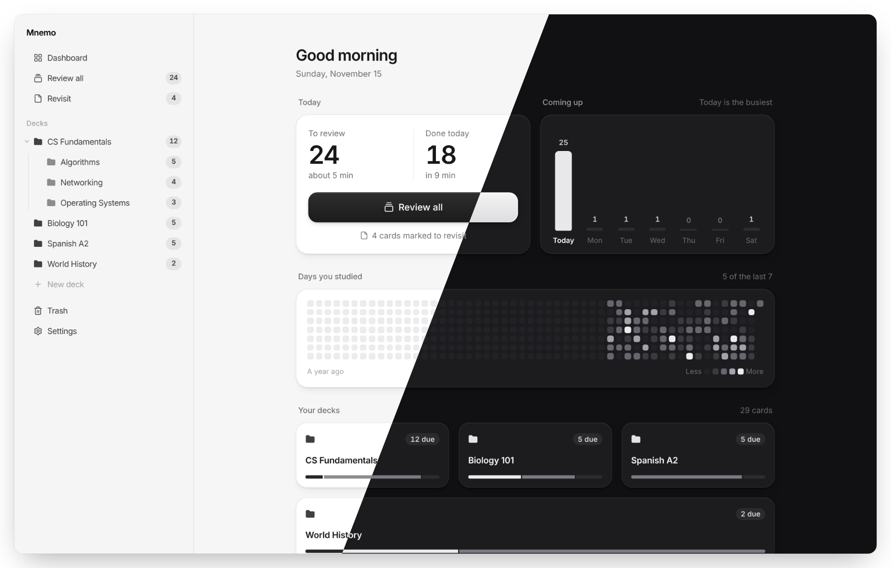
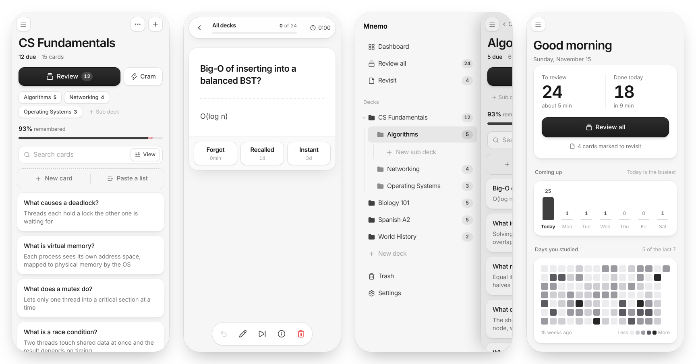
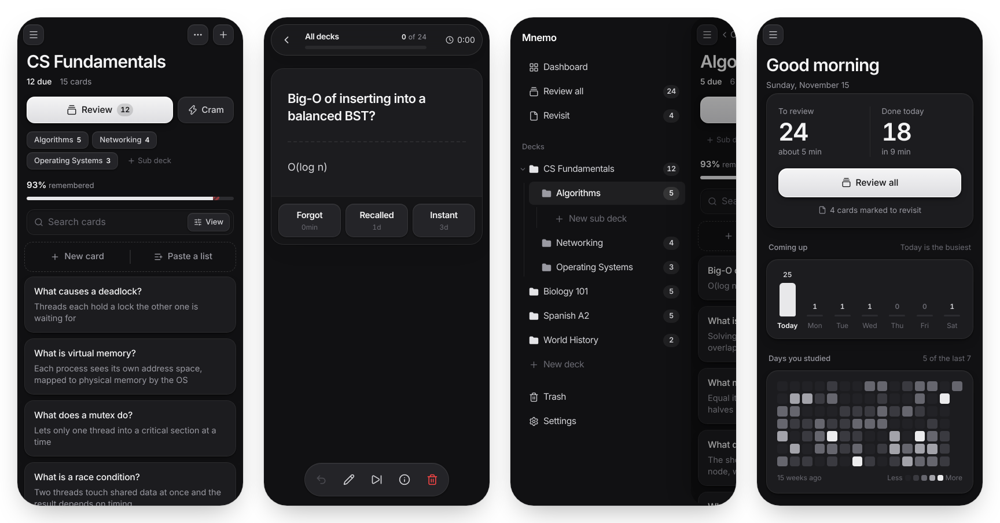
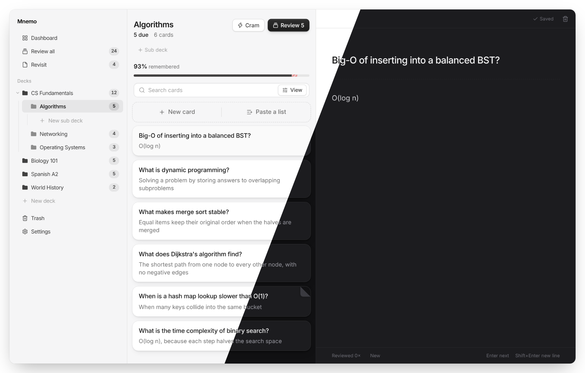
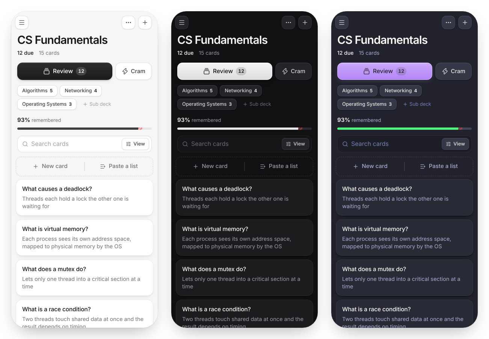

# Oscilo

**Turn your notes into knowledge that lasts.**

Oscilo is a modern learning workspace that brings together rich notes, AI-assisted flashcards, adaptive spaced repetition, and memory insights. Write what you're learning, turn key facts into reviewable questions, and revisit them when it matters.

### AI flashcards grounded in your notes

Oscilo suggests concise, atomic flashcards from **the text you provide**, rather than searching the internet for extra material. The generator is instructed to:

- Use only facts explicitly supported by your note—no outside knowledge or invented details.
- Write self-contained questions that name the topic, so cards make sense outside their original note.
- Keep answers short and clear, correcting spelling and grammar without changing the underlying fact.
- Skip uncertain statements, opinions, tasks, and material that isn't suitable for a factual recall question.
- Return no suggestions when the note doesn't contain a supported, testable fact.

Suggestions use **GPT-OSS 20B via Groq**, structured responses, request limits, and a debounced, cached editor workflow. These safeguards are intended to reduce unsupported content; as with any AI system, **review suggestions before relying on them**.

### Learn with intention

- **FSRS-6 scheduling:** A C++/WebAssembly scheduler adapts review timing to your memory.
- **Memory insights:** See estimated retention, upcoming reviews, and how knowledge develops across decks.
- **Connected notes and cards:** Keep learning material and review questions in the same workspace.
- **Flexible studying:** Review due cards, cram, revisit marked material, and practice individual hidden words or steps.
- **Built for focus:** Responsive layouts, offline-friendly navigation, themes, and local backups.



## Screenshots

**On a phone, light and dark**





**Deck and card editor on desktop**



**Themes: Light, Dark, and Dracula**



## Features

- **Spaced repetition with FSRS-6.** Every review updates the card's stability and difficulty, and the next review is scheduled for when your chance of remembering drops to 90%.
- **Memory forecast.** Each deck shows how much you remember today and how many cards you are likely to forget in the next three days.
- **Decks and sub decks.** Decks nest up to three levels deep. Due counts and reviews include every card underneath.
- **Dashboard.** What is due today, the week ahead, the days you studied, and how well you know each deck.
- **Review all.** One session with every due card across all decks.
- **Cram.** Practice the weakest, marked, or previously missed cards without changing the review schedule, with a summary of what you missed.
- **Rich cards.** Bold, italic, highlights, lists, links, code with syntax highlighting for 20 languages, and LaTeX math, all from a toolbar so no syntax is needed.
- **Hidden words and steps.** Hide words in a sentence, in code, or in math, and learn numbered lists one step at a time. Each hidden word and each step gets its own schedule, so the parts you forget come back sooner.
- **Fast card entry.** Type cards straight into the list, or paste a list of terms and definitions to add many at once.
- **Revisit.** Swipe a card left and tap Revisit to mark it, then practice every marked card from all decks in one session.
- **Trash.** Deleted decks and cards can be restored for 30 days.
- **Themes and layouts.** Light, Dark, and Dracula, or follow the device setting automatically. On larger screens the menu can be Flowing or Floating, and dragged to any width.
- **Backups.** Export everything to a file and import it on any device.
- **Made for phones.** Swipe gestures, screen transitions, a menu you can swipe open from anywhere, and full screen mode when added to the home screen.

## How it works

The scheduler is written in C++ and compiled to WebAssembly with Emscripten, so the same tested code runs in the browser. It implements FSRS-6: given a card's stability, difficulty, and the time since its last review, it predicts the chance you still remember it and picks the next interval.

The app is built with Next.js, React, and TypeScript. Cards and decks are stored locally in the browser. Scheduling, session order, cram rounds, the deck tree, and the paste parser are plain functions with unit tests.

## Tech stack

- Next.js 16 and React 19
- TypeScript
- Tailwind CSS 4
- Motion for gestures and animation
- C++ and WebAssembly for the scheduler
- Vitest and CTest for tests
- GitHub Actions and Vercel for CI and deploys

## Project structure

```
engine/          C++ FSRS scheduler, its tests, and the WebAssembly bindings
src/app/         Pages: home, deck, study, cram, review all, revisit, trash
src/components/  Shared interface pieces: side menu, cards, sheets, study screen
src/data/        Storage, the deck tree, the trash, backups, themes, and the paste parser
src/scheduler/   Ratings, due queues, cram rounds, and memory forecasts
src/engine/      TypeScript wrapper around the WebAssembly scheduler
```

## Running locally

Requires Node.js and the Emscripten SDK.

```bash
npm install
npm run dev
```

The dev and build scripts compile the scheduler to WebAssembly first.

## Tests

```bash
npm test
```

This runs the C++ scheduler tests, builds the WebAssembly module, and runs the TypeScript tests.

## License

Copyright (c) 2026 Jaquan Johnson. All rights reserved. See [LICENSE](LICENSE).
